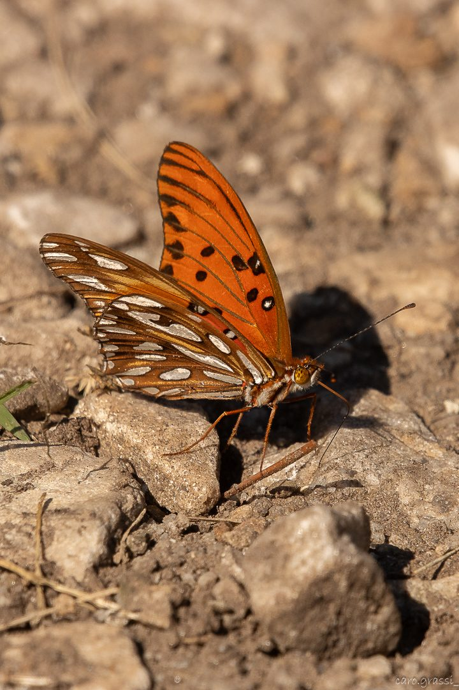
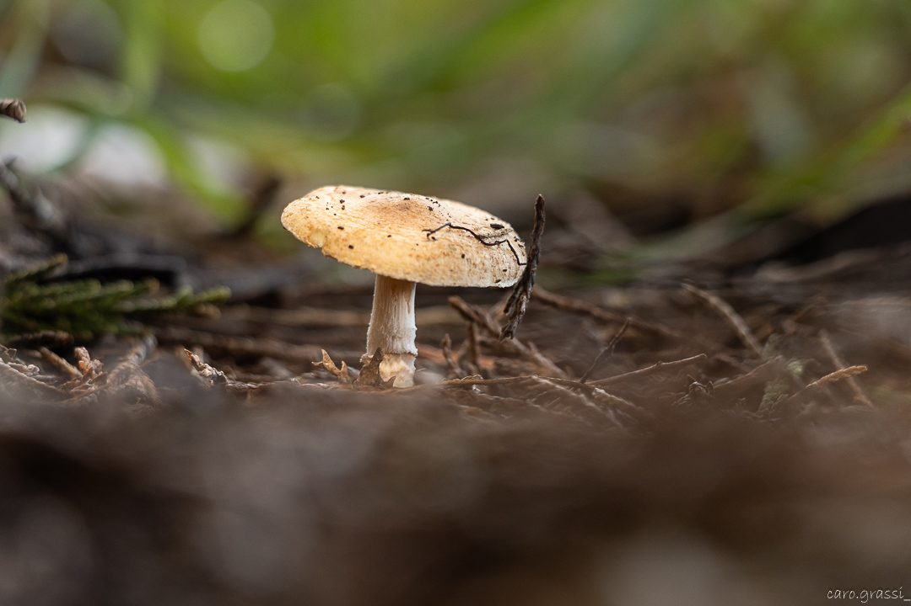
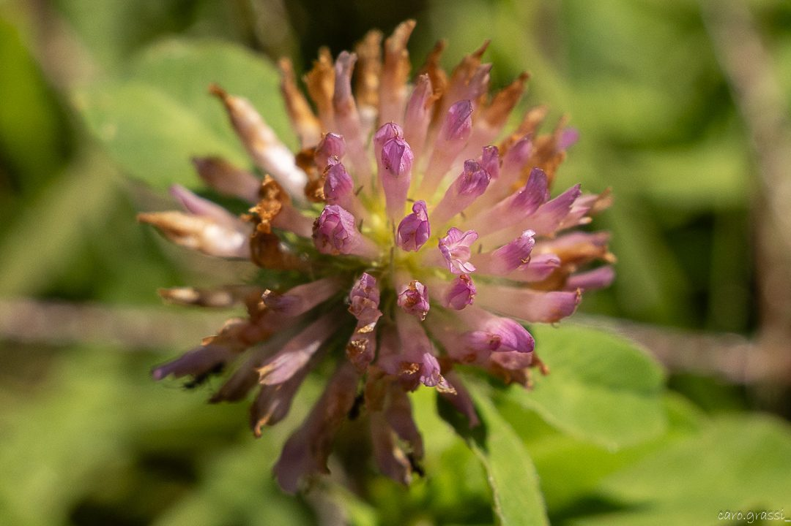
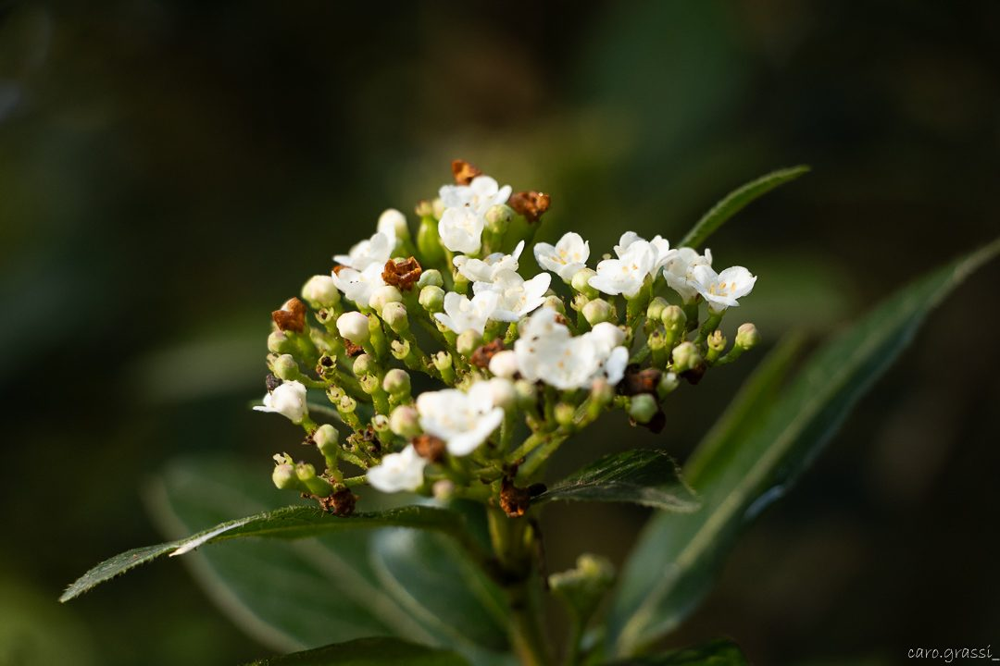

```{r}
#| label: setup
source("scripts/cargar_datos.R")
library(dplyr)

# --- Índices de biodiversidad (sobre los árboles) ---
sp <- arboles$nombre_cientifico[tiene_valor(arboles$nombre_cientifico)]
ab <- table(sp)
S  <- length(ab)                 # riqueza de especies
N  <- sum(ab)                    # individuos
p  <- as.numeric(ab) / N
H  <- -sum(p * log(p))           # Shannon
D1 <- 1 - sum(p^2)               # Simpson (1 - D)
J  <- if (S > 1) H / log(S) else NA   # Pielou (equitatividad)
n_fam <- dplyr::n_distinct(arboles$familia[tiene_valor(arboles$familia)])
n_gen <- dplyr::n_distinct(sub(" .*", "", sp))

# --- Carbono ---
medidos   <- sum(!is.na(arboles$co2_kg))
co2_total <- sum(arboles$co2_kg, na.rm = TRUE)
co2_prom  <- if (medidos > 0) co2_total / medidos else NA
```

El arboretum no es sólo una colección de árboles: es un **ecosistema que se puede
medir**. Aquí resumimos su diversidad biológica y su aporte a la captura de carbono.

## La vida que lo habita

Más allá de los árboles, el arboretum sostiene una red de vida: insectos, hongos,
flores y aves que forman parte de su ecosistema.

```{=html}
<div style="display:grid;grid-template-columns:repeat(auto-fill,minmax(200px,1fr));gap:14px;margin:1.1rem 0 .4rem;">
  <figure style="margin:0;"><figcaption style="font-size:.85rem;color:#6E746C;margin-top:.35rem;text-align:center;">Mariposa</figcaption></figure>
  <figure style="margin:0;"><figcaption style="font-size:.85rem;color:#6E746C;margin-top:.35rem;text-align:center;">Hongos del sotobosque</figcaption></figure>
  <figure style="margin:0;"><figcaption style="font-size:.85rem;color:#6E746C;margin-top:.35rem;text-align:center;">Flores y polinizadores</figcaption></figure>
  <figure style="margin:0;"><figcaption style="font-size:.85rem;color:#6E746C;margin-top:.35rem;text-align:center;">Floración</figcaption></figure>
</div>
<p style="font-size:.8rem;color:#9aa09a;text-align:right;margin:.1rem 0 0;">Fotografías: Carola Grassi</p>
```

## Diversidad biológica

```{r results='asis'}
tarjeta <- function(v, e, sub = "") paste0(
  "::: {.g-col-4 .card .p-3 .text-center .shadow-sm .m-1}\n",
  "<div style='font-size:2rem;font-weight:700;color:#1E4A38;'>", v, "</div>\n",
  "<div>", e, "</div>",
  if (nzchar(sub)) paste0("<div style='font-size:.75rem;color:#888;'>", sub, "</div>") else "",
  "\n:::\n\n")
cat("::: {.grid}\n\n")
cat(tarjeta(S, "Riqueza de especies", "especies distintas"))
cat(tarjeta(n_gen, "Géneros"))
cat(tarjeta(n_fam, "Familias"))
cat(tarjeta(round(H, 2), "Índice de Shannon", "diversidad (H')"))
cat(tarjeta(round(D1, 2), "Índice de Simpson", "1 − D"))
cat(tarjeta(round(J, 2), "Equitatividad de Pielou", "0 a 1"))
cat(":::\n\n")
```

::: {.callout-note collapse="true"}
## Qué significan estos índices
La **riqueza** es la cantidad de especies distintas. El **índice de Shannon (H')**
combina cuántas especies hay y qué tan parejas son sus abundancias: cuanto más alto,
más diverso. El **índice de Simpson (1 − D)** es la probabilidad de que dos individuos
tomados al azar sean de especies diferentes (cerca de 1 = muy diverso). La
**equitatividad de Pielou** va de 0 a 1 e indica qué tan equilibradas están las
abundancias entre especies.
:::

## Captura de carbono

Cada árbol almacena carbono en su tronco, ramas y raíces. Estimamos ese aporte a
partir del **diámetro del tronco (DAP)** y la **altura**, usando ecuaciones
alométricas reconocidas (Chave et al., 2014) y la fracción de carbono del IPCC.

```{r results='asis'}
if (medidos == 0) {
  cat(":::{.callout-tip}\n")
  cat("**Listo para medir.** El cálculo de carbono se activa automáticamente a medida ",
      "que se cargan los diámetros de tronco en la base (columna `diametro_cm`). ",
      "Hoy hay **", medidos, " de ", nrow(arboles), "** árboles con diámetro cargado.\n", sep = "")
  cat(":::\n\n")
} else {
  cat("::: {.grid}\n\n")
  cat(tarjeta(round(co2_total/1000, 1), "Toneladas de CO₂", "estimadas, total"))
  cat(tarjeta(round(co2_prom, 0), "kg de CO₂ por árbol", "promedio"))
  cat(tarjeta(paste0(medidos, "/", nrow(arboles)), "Árboles medidos"))
  cat(":::\n\n")
}
```

**Cómo se calcula (ejemplo).** Un árbol con **40 cm** de diámetro de tronco y
**12 m** de altura almacena del orden de **`r round(estimar_agb_kg(40,12)*0.47*3.667)` kg de CO₂**
equivalente. El valor real de cada ejemplar aparecerá en su ficha a medida que se
tomen las mediciones.

::: {.callout-warning}
Se trata de una **estimación educativa** para dimensionar el aporte del arboretum,
no de un inventario de carbono certificado. Los parámetros (densidad de madera,
ecuación) pueden ajustarse por especie para mayor precisión.
:::

---

*Todos los indicadores se recalculan automáticamente desde la base maestra en cada actualización.*
